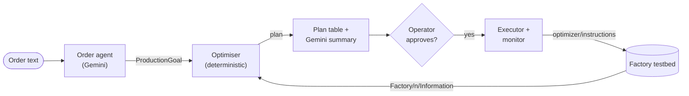

# Agentic Production Planner

[](https://github.com/zhangyuan-nus/agentic-production-planner/actions/workflows/ci.yml)

Turns a plain-English production order into a machine-level plan for a simulated four-factory
plant, asks an operator to approve it, dispatches it over MQTT, and switches the machines back off
once the order is done.

```console
$ python -m production_planner --order "make 500 p123 by 6pm today, use existing stock"
```

An LLM (Gemini) handles the language: reading the order and explaining the plan. Everything
numeric, from bill-of-materials expansion and stock netting to machine selection and timing, is
deterministic Python with unit tests.

This was my part of *Agentic AI for Industry 5.0*, a final-year design capstone at the National
University of Singapore (see [Background](#background)).

## How it works



1. **Order agent** ([`order_agent.py`](production_planner/order_agent.py)). Gemini turns free
   text into a `ProductionGoal` using structured output against a Pydantic schema. It is given
   the operator's local time, so "by 6pm today" becomes an absolute deadline. It never sees stock
   levels or does arithmetic.
2. **Snapshots** ([`snapshot.py`](production_planner/snapshot.py)). Every factory publishes its
   machine states and container levels each second; the planner takes the latest message from
   each factory.
3. **Optimiser** ([`optimizer.py`](production_planner/optimizer.py)). Expands the order through
   the bill of materials and subtracts existing stock top-down. It then enables idle machines at
   the slowest stage until no stage can be sped up, and a trim pass drops any machine whose
   removal doesn't change the finish time. The deadline check includes the 10 s machine start-up.
4. **Review** ([`cli.py`](production_planner/cli.py), [`summary.py`](production_planner/summary.py)).
   The operator sees a stage-by-stage table and, optionally, a Gemini-written summary for a plant
   manager. Nothing is published until they approve.
5. **Dispatch and auto-stop** ([`executor.py`](production_planner/executor.py)). The approved
   plan is published to `optimizer/instructions`. The planner then watches stock, and when the
   order is complete it sends a stop message that switches off only the machines it turned on.

## Example

[`examples/snapshot.json`](examples/snapshot.json) is a plant state in the testbed's payload
format. Some machines are already running at degraded rates, there is stock in containers and on
a lorry, and an operator has forced down F3M5b, the backup p123 machine. Planning 500 units of
p123 against it needs no broker or API key:

```console
$ python -m production_planner --part p123 --qty 500 --use-existing-stock \
      --snapshot-file examples/snapshot.json --no-llm
[planner] Loaded snapshots for factories 1, 2, 3, 4 from examples/snapshot.json

===== PRODUCTION PLAN =====
  Order       : 500 x p123 (deadline: none)
  Feasible    : yes
  Estimate    : 50s of production + 10s machine start-up
  Bottleneck  : p123
  Stock       : drawing p1 x120, p2 x80, p3 x35

  Stage  Factory  Machines on   Rate/s  Stock  To make  Time s
  p1     F1       F1M1             8.0    120      380    47.5
  p2     F2       F2M2            10.0     80      420    42.0
  p12    F2       F2M3, F2M3b     19.0      0      500    26.3
  p3     F3       F3M4, F3M4b     15.0     35      465    31.0
  p123   F3       F3M5            10.0      0      500    50.0  <- bottleneck

  Machine actions (3):
    ENABLE  F3M5   Factory 3, part p123 (+10/s)
    ENABLE  F3M4b  Factory 3, part p3 (+10/s)
    ENABLE  F2M3b  Factory 2, part p12 (+10/s)

  Warnings:
    - Machine(s) F3M5b are forced down (state -2) and were left out of the plan.
    - Trim pass removed 2 redundant machine enable(s); the remaining set still meets the
      bottleneck time.
    ...

[planner] Offline mode: this payload would be published to 'optimizer/instructions':
{ ... }
```

With F3M5b forced down, p123 can only be made at 10 units/s, so it is the bottleneck at 50 s.
The greedy pass also enabled F1M1b and F2M2b, but p1 and p2 already finish inside 50 s on one
machine each, so the trim pass dropped them.

## Design decisions

- **The LLM never touches the numbers.** Gemini translates (order text to schema) and explains
  (plan to summary). Stock, demand and capacity are computed in plain Python, so plans are
  repeatable and every number in them is covered by tests. The order schema is deliberately small,
  and Pydantic validates the model's output before the optimiser sees it.
- **A person approves every dispatch.** Plans are shown before anything is published. If the
  model rates its own parse below 0.6 confidence, the parsed order is shown back to the operator
  for confirmation before planning starts.
- **Operators' decisions win.** The testbed would accept an enable for a machine an operator has
  forced down, so the planner never sends one.
- **Fewest machines for the fastest finish.** The greedy pass finds the fastest achievable time,
  and the trim pass removes machines that don't contribute to it.
- **It cleans up after itself.** The stop message disables only the machines the plan enabled,
  so anything that was already running is left alone.
- **Time zones are explicit.** Deadlines are timezone-aware throughout, and a time without an
  offset is read as the operator's local time.
- **Each dependency is optional.** Without an API key, use `--part`/`--qty` and `--no-llm`.
  Without a broker, plan from a saved snapshot. If Gemini fails mid-run, only the summary is lost.

## Quick start

Python 3.10 or newer:

```bash
python -m venv .venv
source .venv/bin/activate        # Windows: .venv\Scripts\activate
pip install -e ".[dev]"
```

**1. Plan offline.** Run the [example](#example) above.

**2. Run the full loop locally.** You need an MQTT broker on `localhost:1883`, for example
[Mosquitto](https://mosquitto.org/download/) (`brew install mosquitto`,
`sudo apt install mosquitto`, or the Windows installer). Start the mock testbed from the example
state:

```bash
python -m mock_testbed --from-snapshot examples/snapshot.json
```

Then, in a second terminal, plan, approve and watch the order complete:

```console
$ python -m production_planner --part p123 --qty 500 --use-existing-stock --no-llm
...
Apply these 3 machine action(s)? [Y/n]: y
[planner] Published plan to 'optimizer/instructions'.

===== MONITORING PRODUCTION =====
  Target part       : p123
  Baseline stock    : 0
  Units to produce  : 500
  Stop threshold    : 500 (baseline + units_to_produce)
  Poll interval     : 2s  |  Max wait: 300s
  [   0.0s]  p123 stock =      0  produced =      0/500  (  0.0%)
  [  16.0s]  p123 stock =     50  produced =     50/500  ( 10.0%)
  [  22.1s]  p123 stock =    110  produced =    110/500  ( 22.0%)
  ...
  [  56.1s]  p123 stock =    450  produced =    450/500  ( 90.0%)
  [  62.2s]  p123 stock =    510  produced =    510/500  (100.0%)

[planner] Order complete: produced 510 unit(s) of p123.
[planner] Published stop instructions to 'optimizer/instructions' (disabling 3 machine(s)).
```

The order completed 62 s after dispatch, against an estimate of 10 s of start-up plus 50 s of
production. To see the safety rule, force the other p123 machine down with
`mosquitto_pub -t "F3M5 down" -m true` and plan again: the planner reports the order as
infeasible rather than reviving either machine.

**3. Add Gemini.** Copy [`.env.example`](.env.example) to `.env` and set `GEMINI_API_KEY` (from
[Google AI Studio](https://aistudio.google.com/apikey)) or the Vertex AI variables. Then:

```bash
python -m production_planner --order "make 500 p123 by 6pm today, use existing stock"
python -m production_planner.order_agent --interactive    # try the order agent on its own
```

The default model is `gemini-3.8-flash`; set `GEMINI_MODEL` to use another.

## Command line

| Option | Effect |
| --- | --- |
| `--order TEXT` | Natural-language order, parsed by Gemini |
| `--part`, `--qty`, `--deadline` | The same order as flags, with no LLM involved |
| `--use-existing-stock` | Count container and lorry stock against the order |
| `--snapshot-file FILE` | Plan against a saved snapshot and print the payload instead of publishing |
| `--no-llm` | Skip the Gemini summary |
| `--auto-confirm` | Publish without the approval prompt |
| `--no-monitor` | Dispatch and exit, leaving the machines on |

`python -m production_planner --help` lists every option. The exit code is 0 when the run
succeeds or is cancelled, 1 for an infeasible plan or a monitor timeout, and 2 for usage,
connection and order-parsing errors.

## MQTT contract

The planner uses the same topics and payloads as the team's testbed.

**Factories to planner.** Each factory publishes on `Factory/<n>/Information` every second
(abridged):

```json
{
  "machines_information": {
    "Machine 5": {"state": -1},
    "Machine 5b": {"state": -2}
  },
  "container_information": {
    "Container A": {"part": "P123", "amount": 0}
  },
  "lorry_cargo": {
    "Lorry 1": {"P1": 40, "P2": 0, "P12": 0, "P23": 0}
  }
}
```

| Machine state | Meaning | Units per second |
| --- | --- | --- |
| 0, 1, 2, 3 | Working, slowing as it wears | 10, 9, 8, 5 |
| 4 to 9 | Maintenance or failure | 0 |
| -1 | Disabled | 0 |
| -2 | Forced down by an operator | 0 |

**Planner to factories.** Plans are published on `optimizer/instructions`:

```json
{
  "type": "optimization_plan",
  "version": 1,
  "goal": {"target_part": "p123", "quantity": 500, "deadline": null},
  "actions": [
    {"machine_id": "F3M5", "factory_id": "3", "part": "p123", "action": "enable"}
  ]
}
```

The stop message has type `optimization_plan_stop` and the same actions with
`"action": "disable"`. A newly enabled machine starts producing after 10 s.

**The plant.** Every machine has a backup with a `b` suffix (F3M5b), and lorries carry p1, p2, p12
and p23 between factories.

| Factory | Machine | Makes | From |
| --- | --- | --- | --- |
| F1 | M1 | p1 | |
| F2 | M2 | p2 | |
| F2 | M3 | p12 | p1 + p2 |
| F3 | M4 | p3 | |
| F3 | M5 | p123 | p12 + p3 |
| F3 | M6 | p23 | p2 + p3 |
| F4 | M7 | p4 | |
| F4 | M8 | p234 | p23 + p4 |

## Project layout

```text
production_planner/
  cli.py          command line: order, plan, approval, dispatch, auto-stop
  order_agent.py  Gemini order parsing into a ProductionGoal
  optimizer.py    BOM expansion, stock netting, machine selection, deadline check
  snapshot.py     collects factory snapshots and totals the stock in them
  executor.py     instruction payloads, publishing and the completion monitor
  summary.py      Gemini plan summary for a plant manager
  models.py       Pydantic models shared by the pipeline
  config.py       plant layout, machine rates, MQTT and model settings
  mqtt_io.py      MQTT connection helpers
mock_testbed/     SimPy stand-in for the team's testbed (the model is in plant.py)
examples/         sample factory snapshot
tests/            pytest suite, run by CI on Python 3.10 to 3.13
```

## Tests

```bash
pytest           # 67 tests; no broker or API key needed
ruff check .
```

The suite covers the optimiser's arithmetic (including a diamond-shaped BOM in which two branches
share a component), the order agent against a fake Gemini client, and the CLI's exit codes. It also
runs a closed loop in which a plan is applied to the mock testbed and the order completes at the
estimated time.

## Limitations and future work

- **Nominal rates.** The planner uses each machine's per-state rate. The team's full testbed also
  moves parts along each internal link at 1 unit per second and carries parts between factories
  by lorry, so orders there take longer than the estimate. The planner reports both as warnings
  rather than modelling them; calibrating effective rates from observed throughput is the next
  step.
- **One part per order.** An order names a single target part. Combined orders ("500 p1 and
  200 p12") would need demand aggregated across targets.
- **Fastest plan, not leanest.** When a deadline has slack, the plan could use fewer machines and
  still meet it.
- **Snapshots can go stale.** The plan uses the snapshot read at the start. Re-reading machine
  states just before publishing would catch changes made while the operator was reviewing.
- **Approximate stop.** The monitor polls every 2 s, so the stop can arrive a couple of seconds of
  production late (510 units instead of 500 in the run above).

## Background

*Agentic AI for Industry 5.0* was a four-person design capstone (EE4002D) at the National
University of Singapore in AY2025/26, supervised by Dr Tham Chen Khong. The team built:

- the SimPy factory testbed with its MQTT layer, and a monitoring agent that watches it for
  anomalies (Li Zheng Ting)
- a digital-twin simulation and a Google ADK multi-agent system (Loh Yong Teng)
- a live digital-twin dashboard on Google Maps (Serzen Gurung)
- this production-planning agent (Zhang Yuan)

This repository contains only the production-planning agent. `mock_testbed/` is a simplified
stand-in, added after the project, so the planner can be run end to end without the team's code.
During the project the agent used Gemini 2.5 Flash through Vertex AI. Google has since retired
that model on Vertex, so the default is now `gemini-3.8-flash`.
